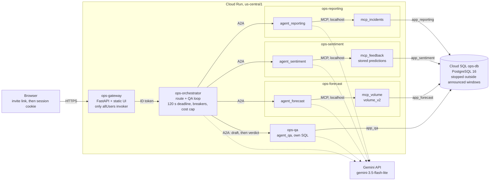

# Agentic Service Operations Intelligence Platform

Northwestern capstone. A multi-agent system over a synthetic field-service dispatch
database: an orchestrator routes natural-language intent via A2A to reporting,
sentiment, and forecast agents, each calling scoped tools through its own MCP server,
with a QA agent verifying output before it returns.

Design documents live in [docs/](docs/) — start with
[architecture.md](docs/architecture.md). Schema detail is in
[data-dictionary.md](docs/data-dictionary.md); the reasoning behind every locked
decision is in [decisions-log.md](docs/decisions-log.md).

## Status

*Updated 2026-10-18 (S6-R1: dates, the trigger sentence, the diagram and the setup steps).*

Sprint 5 closed on 2026-10-13. The system is built end to end and deployed: a gateway with
invite-link sign-in and a single-screen UI, the orchestrator, the reporting, sentiment and forecast
agents with their MCP servers, and the QA agent that verifies each answer before it returns. It
runs on Cloud Run over Cloud SQL (`ops-db`, stopped outside announced grading windows,
ADR-105, ADR-107). Model calls use the paid Gemini key with the free key still mounted beside it
(ADR-104). One MVP functional requirement is unmet: FR-03, handling
ambiguous questions, which failed two pre-registered gates (ADR-075, ADR-076, ADR-101). The
interpretation check is advisory (ADR-102). The deploy YAML has been synced to the paid key
(`381bd3f`); the build trigger stays disabled outside deploy windows (ADR-105). Sprint 6
(2026-10-15 to 10-25, ADR-109) is hardening and delivery; the buffer runs 10-26 to 12-05. Sprint
status is in [docs/sprint-log.md](docs/sprint-log.md); requirement-by-requirement evidence is in
[docs/requirements-traceability.md](docs/requirements-traceability.md).

### Deployed architecture

Six Cloud Run services: the **gateway** (FastAPI plus the static UI; the only public ingress; invite
links, ADR-097), the **orchestrator** (routes by LLM and sends A2A messages), and the **reporting**,
**sentiment** and **forecast** agents plus the **QA** agent. Each MCP server is a sidecar of its
agent and the only holder of that domain's database role (ADR-079). Deployed sentiment reads stored,
offline-scored predictions only (ADR-100). Services authenticate to each other with Cloud Run IAM
ID tokens (ADR-081). Only the gateway is public. Access for graders is by invite link in announced
windows; the procedure is [deploy/RUNBOOK_GRADING.md](deploy/RUNBOOK_GRADING.md).



How to read it:

- Solid edges are requests (HTTPS, A2A, MCP, SQL); dotted edges are model calls. The gateway and the
  three MCP servers make none.
- The orchestrator owns the QA loop; specialists return drafts to it and never call QA (ADR-055).
  Each MCP server is a sidecar of its agent, reached over localhost, and holds only its own role's
  credential (ADR-079). QA has no sidecar and reads with its own role.
- Only the gateway has an `allUsers` invoker (people sign in by invite link, ADR-097). Every other
  service requires an IAM ID token from its caller (ADR-081); ingress is open and IAM is the boundary. No runtime role has a grant on
  `contacts`, so customer PII never reaches a model.
- This is the deployed topology. Locally, compose runs each MCP server as its own container
  (ADR-079).

## Local setup

Requires Python 3.12, [uv](https://docs.astral.sh/uv/) (CI uses 0.12.19), and (for the
database) Docker Desktop. `uv.lock` pins every dependency; local, CI and the service
images all install from it (ADR-047). On Windows, clone to a short path (for example `C:\asops`):
some dependency file paths exceed 260 characters when the clone is nested deeply, and the unit suite
then fails at collection.

What each stage needs:

| Stage | Needs |
|---|---|
| Offline unit tests (`pytest tests/unit services`) | Neither Docker, a key nor the weights |
| Database layer: Postgres, Alembic, generator and loader, the integration suite | Docker Desktop running. No real key, no weights |
| Full stack, "Run the system locally" below | A real free-tier Gemini key, and the gitignored sentiment weights under `models/sentiment/bert_v1/`, which are not distributed |

```
uv sync --locked --all-packages --all-extras --python 3.12

copy .env.example .env      # then fill in POSTGRES_*, DB_ROLE_*_USER and DB_ROLE_*_PASSWORD
```

Also give `GOOGLE_AI_API_KEY` a value in `.env` before the next step. Compose checks the whole file,
so `docker compose up -d postgres` stops with `required variable GOOGLE_AI_API_KEY is missing a
value` if it is blank, even though Postgres never uses it. For the database-only steps any
placeholder works (for example `placeholder`); a real key is needed only for "Run the system
locally".

`.env` is gitignored and holds every credential. Nothing is hardcoded: Alembic builds
its connection string from `POSTGRES_ADMIN_USER` / `POSTGRES_ADMIN_PASSWORD` /
`POSTGRES_HOST` / `POSTGRES_PORT` / `POSTGRES_DB`, and each role's name and password come
from `DB_ROLE_*_USER` and `DB_ROLE_*_PASSWORD` — both required, never defaulted (ADR-028). In deployment the same variables come from GCP Secret Manager.

```
docker compose up -d postgres
.venv\Scripts\python -m alembic upgrade head
```

That applies every migration in `data/migrations/versions/`, beginning with the schema, the first five
least-privilege roles (ADR-063 later made it seven: four runtime and three offline) with the
grants from [data-dictionary.md §7](docs/data-dictionary.md), the column-level narrowing
of the sentiment and forecast grants (ADR-027, ADR-035), two schema changes to the
ground-truth tables (ADR-037, ADR-038), and the site region on `locations` (ADR-051).

To load the synthetic dataset from the committed corpus and validate it:

```
.venv\Scripts\python data/generator/load.py --corpus data/generator/corpus/feedback_text.jsonl
.venv\Scripts\python data/generator/validate.py
```

Local development uses Docker Postgres; the deployed system uses Cloud SQL. The same
migrations run against both, and the deployed database holds the same generated dataset
(a data-parity check on 2026-10-13 matched the local one).

## Run the system locally

*Updated 2026-10-14. This section began as the walking-skeleton walkthrough; the stack is now the
full system.* `docker compose up -d --build` builds and starts Postgres, the three MCP servers, the
four agents, the orchestrator and the gateway. A routed, parsed and verified answer needs a model
key in `.env` (`GOOGLE_AI_API_KEY`; `LLM_MODE` blank means the free key, ADR-104 describes the paid
mode) and, for the sentiment MCP server, the gitignored model weights under `/models/` (ADR-066).
Without the weights nothing answers end to end: `mcp_feedback` verifies them against the manifest
at start-up and refuses to start, `agent_sentiment` waits for it, the orchestrator waits for all four
agents and the gateway for the orchestrator. Compose does not pass `MCP_FEEDBACK_SCORING` through,
so `.env` cannot switch the server to the deployed stored-predictions mode. The reporting, forecast
and QA services do not depend on the sentiment pair and can be started by name
(`docker compose up -d --build mcp_incidents agent_reporting`), but nothing routes to them without
the orchestrator. The fastest end-to-end check is the orchestrator's CLI:

```
docker compose up -d postgres
.venv\Scripts\python -m alembic upgrade head
.venv\Scripts\python data/generator/load.py --corpus data/generator/corpus/feedback_text.jsonl
docker compose up -d --build
.venv\Scripts\python -m orchestrator ask "How many incidents were reported last quarter?"
```

The gateway needs `GATEWAY_SESSION_KEY` and an invite
(`.venv\Scripts\python scripts/invites.py create --label me --days 7` prints the link once). Only the
orchestrator and the gateway publish host ports, both on loopback. The agent and orchestrator
containers hold no database credentials; each MCP server holds only its own role. Every service logs
JSON lines carrying the same `trace_id`. To follow one request across services, run
`docker compose logs orchestrator agent_reporting mcp_incidents`. The e2e tests check this against the
running stack:

```
$env:RUN_E2E=1; .venv\Scripts\python -m pytest tests/e2e -q -rs
```

## Local environment recovery

The local stack (Docker Desktop on WSL2) has run out of memory more than once (R-17). The
setup below is the owner's, recorded 2026-10-05 and owner-verified the same day;
`.wslconfig` is machine configuration and is not in this repo.

**Symptoms:** Docker or WSL fails, or the machine becomes unresponsive.

**Prevention:**
- Keep `memory=6GB` and `autoMemoryReclaim=dropcache` set in `.wslconfig`, and keep Docker's
  data on `D:` (the disk image is at `D:\DockerData\DockerDesktopWSL`).
- Stop the stack (`docker compose down`) before heavy jobs: BERT training or scoring,
  full-stack rebuilds, eval runs. Check free memory before a long run or a full-stack rebuild.

**Recovery:** restart Windows. Do not use `wsl --shutdown`. After the restart, bring the
stack back with `docker compose up -d --build`; the first start is slower on a cold file
cache (29.4 s against 14.9 s for `mcp_feedback`, L-36).

## Verifying the database layer

```
.venv\Scripts\python -m pytest tests/unit services -q   # no database needed
.venv\Scripts\python -m pytest tests/integration -q   # live grants; skips if no database (REQUIRE_INTEGRATION_DB=1 makes skips fail)
.venv\Scripts\python -m alembic check          # "No new upgrade operations detected."
```

`alembic check` matters more than usual here: the initial migration was written by
hand (no database was reachable at the time), so it is the authoritative proof that
the migration and `packages/db_models/` agree. If it reports pending operations, the
migration is wrong, not the models.

### Confirming the security boundary

The least-privilege claim is worth demonstrating rather than asserting. Connect as
each role and check that the walls are where the access matrix says they are:

```sql
-- as app_sentiment: its entire world is four columns of one table
SELECT feedback_text FROM service_feedback LIMIT 1;   -- succeeds
SELECT rating FROM service_feedback LIMIT 1;          -- ERROR: permission denied (R-04)
SELECT * FROM incidents LIMIT 1;                      -- ERROR: permission denied
SELECT * FROM sentiment_labels LIMIT 1;               -- ERROR: permission denied

-- as app_reporting: can aggregate ratings, cannot read the customer's words
SELECT avg(rating) FROM service_feedback;             -- succeeds
SELECT feedback_text FROM service_feedback LIMIT 1;   -- ERROR: permission denied

-- as any agent role: customer PII is unreachable
SELECT * FROM contacts LIMIT 1;                       -- ERROR: permission denied
```

Those failures are the point of the design: the sentiment agent cannot verify itself
against its own ground truth, cannot see the rating QA checks it against, staff-written
incident notes cannot reach the sentiment pipeline, and customer PII never enters an
LLM context window. Each is enforced by a database grant rather than a code convention
— see ADR-023, ADR-025 and ADR-027.

`tests/integration/test_access_matrix_grants.py` automates this: it logs in as every
role and probes every table for reads and for INSERT/UPDATE/DELETE, plus every column
of `service_feedback` and `service_requests`, with the expected outcome computed from
`db_models.access_matrix`. CI runs it on every push against a Postgres 16 service container.

## Repository layout

*Updated 2026-10-14.* See [architecture.md §11](docs/architecture.md).

```
packages/db_models/     SQLAlchemy models, controlled vocabularies, §7 access matrix
packages/common/        JSON-line logging and trace-id propagation
packages/schemas/       Pydantic contracts shared across services
packages/a2a_core/      shared A2A server and client plumbing
packages/llm/           model client: retries, breaker, spend caps, free and paid modes
packages/forecast_runtime/  the forecast model's serving code
services/mcp_incidents/ mcp_feedback/ mcp_volume/   one MCP server per domain, each as its own role
services/agent_reporting/ agent_sentiment/ agent_forecast/   the specialist agents
services/agent_qa/      the QA agent: independent recomputation and checks
services/orchestrator/  POST /ask, the router, the bounded revision loop, the CLI
services/api_gateway/   invite-link sign-in, limits and the static UI (web/ builds the export)
web/                    the single-screen Next.js front end
data/migrations/        Alembic: identical local and Cloud SQL
data/generator/         parameters, frozen feedback corpus, generator, loader, validation
ml/                     sentiment classifier and volume forecast training
evals/                  routing, parse, QA, golden and generated evaluation sets and results
deploy/                 Cloud Run definitions, runbooks, verify.py
tests/                  unit, integration (live grants, MCP figures), e2e (RUN_E2E=1)
.github/workflows/      CI: lint, unit, integration (CD trigger disabled, ADR-105)
docker-compose.yml      the full local stack
```
